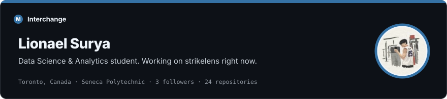
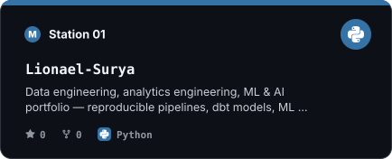
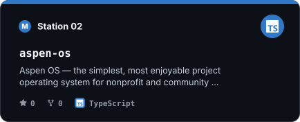
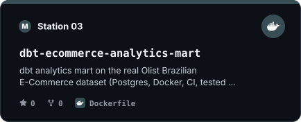
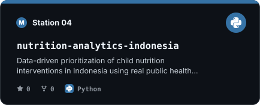
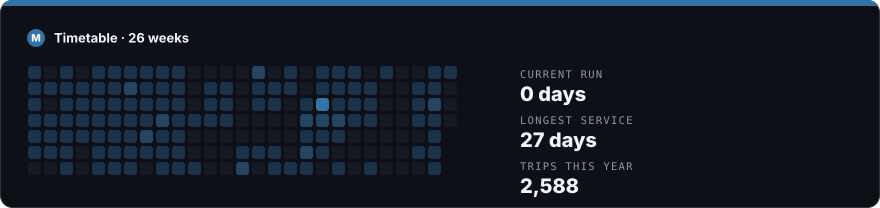

<!--metro:start-->

<picture><source media="(prefers-color-scheme: light)" srcset="assets/metro-light.svg"></picture>

Every line is a language I write; every stop is one of my projects.

<picture><source media="(prefers-color-scheme: light)" srcset="assets/interchange-light.svg"></picture>

<a href="https://github.com/suryalionael/Lionael-Surya"><picture><source media="(prefers-color-scheme: light)" srcset="assets/station-1-light.svg"></picture></a>
<a href="https://github.com/suryalionael/aspen-os"><picture><source media="(prefers-color-scheme: light)" srcset="assets/station-2-light.svg"></picture></a>
 
<a href="https://github.com/suryalionael/dbt-ecommerce-analytics-mart"><picture><source media="(prefers-color-scheme: light)" srcset="assets/station-3-light.svg"></picture></a>
<a href="https://github.com/suryalionael/nutrition-analytics-indonesia"><picture><source media="(prefers-color-scheme: light)" srcset="assets/station-4-light.svg"></picture></a>

<picture><source media="(prefers-color-scheme: light)" srcset="assets/lines-light.svg"></picture>

<picture><source media="(prefers-color-scheme: light)" srcset="assets/timetable-light.svg"></picture>

<!--metro:end-->

### Now boarding

- Data Science & Analytics student at Seneca Polytechnic, Toronto
- Building data pipelines, analytics marts and ML projects end to end
- Looking for a Summer 2027 co-op / internship

[GitHub](https://github.com/suryalionael)

Commit Metro · redrawn every day by <a href="scripts/generate.py">a small script</a> in this repo
